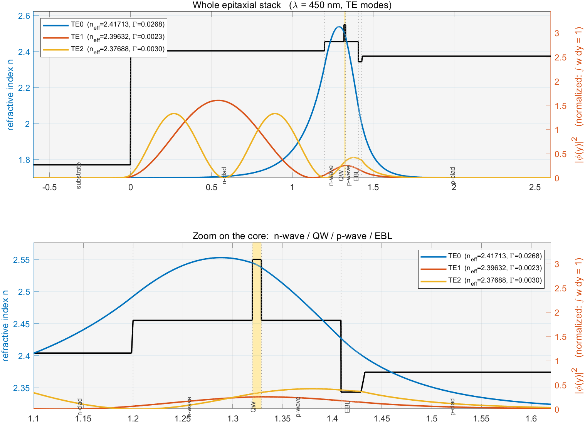

# Model_S1_7L_EBL —— 7 层 GaN 基蓝光 LD 平板波导

> **这份文档写给**：想跟着代码把理论走一遍的人。
> **模型文件**：`Model_S1_7L_EBL.m`（**单文件自包含**，不依赖 `src/` 下的任何东西）
> **环境**：MATLAB R2023b ｜ 长度单位 μm ｜ 波长 450 nm
>
> 本文档 §2 的数字与 §3 的图形都是**实跑出来的**，不是示例值。

---

## 0. 怎么跑

```matlab
cd C:\Users\L\Desktop\UG\GaN_LD\waveguide\Mode_L1
Model_S1_7L_EBL              % 求解 + 画图（图留在屏幕上，可缩放、可取点）
Model_S1_7L_EBL('save')      % 求解 + 导出 PNG 到 out/ebl_modes.png
Model_S1_7L_EBL('9')         % 换用 9 层 MQW 结构
m = Model_S1_7L_EBL();       % 同时把结果返回，接着在命令行算别的
```

**不需要 `startup`，不需要 `addpath`。** 全部依赖都写在 `Model_S1_7L_EBL.m`
下方作为局部函数（§6），把一个 `.m` 拷到任何地方都能跑。

### 命名规则

```
Model_S<阶段号>_<后缀>          后缀 = 层数 + 特征
```

`Model_S1_7L_EBL` = 阶段 1 · 7 层 · 含 EBL。
换结构时**另存为新文件并改后缀**（例如 `Model_S1_9L_MQW`），
不要在原文件上改数字 —— 保留它作为对照组。

> ⚠ 文件名与函数名**必须是 ASCII**。中文名（例如 `一条龙.m`）虽然
> `exist('一条龙.m')` 会返回 2（文件确实找得到），但调用时会报
> "文本字符无效...请检查是否为 ASCII 字符"。文件**内容**里的中文注释
> 与字符串不受影响。

---

# §1 参数定义

## 1.1 在解什么问题

一支 GaN 基蓝光激光器，沿外延生长方向（记为 y）看过去，是一摞折射率不同的薄层。
光在这摞层里能不能被"关住"、关得牢不牢，由下面这个方程决定：

```
d²E/dy² + k₀²·[n²(y) − n_eff²]·E = 0
```

其中 k₀ = 2π/λ 是真空波数，n(y) 是逐层的折射率，**n_eff 是本征值** ——
它的物理含义是"这个模式实际感受到的等效折射率"。

方程本身简单，难的是 n(y) 是**分段常数**。所以在每一层内部 E 是正弦或指数函数，
而在层与层的界面上必须满足连续条件。把这些条件凑到一起，就得到一个只含
n_eff 一个未知数的方程 —— **色散方程**。解它，就是 `Model_S1_7L_EBL` 在做的事。

## 1.2 层结构（★ 最重要的参数表）

定义在 `Model_S1_7L_EBL.m` 的 §6 局部函数 `stack_7layer()` 里：

| # | tag | 材料 | 厚度 d (μm) | 折射率 n @450nm | 角色 |
|---|---|---|---|---|---|
| 1 | `substrate` | Al₂O₃（蓝宝石） | **Inf** | 1.770 | 衬底，半无限 |
| 2 | `n-clad` | n-Al₀.₀₆GaN | 1.200 | 2.404 | n 侧包层 |
| 3 | `n-wave` | n-In₀.₀₄GaN | 0.120 | 2.455 | n 侧波导层 |
| 4 | `QW` | In₀.₁₅GaN | 0.009 | 2.550 | **有源区**（单层等效） |
| 5 | `p-wave` | u-In₀.₀₄GaN | 0.080 | 2.455 | p 侧无掺杂波导层 |
| 6 | `EBL` | p-Al₀.₂₀GaN | 0.020 | 2.343 | 电子阻挡层 |
| 7 | `p-clad` | p-Al₀.₁₀GaN | **Inf** | 2.374 | p 侧包层，半无限 |

**三点必须留意：**

1. **首尾两层厚度是 `Inf`**（半无限）。波导的上下包层在光学意义上确实是半无限
   介质；若人为把它们截断成有限厚度，等于凭空插进两个界面，会解出物理上不
   存在的假模。`build_layers` 对这条**直接报错**，不做静默容忍。
2. **层序从下往上**，`L(1)` 在衬底侧，`L(7)` 在覆盖层侧，y 随层号递增。
   这个方向贯穿模场、Γ 积分和绘图，中途不能反转。
3. **折射率不是单调的**。第 6 层 EBL 的 2.343 比上下两层（2.455 和 2.374）
   都低，形成一个**折射率凹陷** —— 这是整个结构里唯一的"反向"台阶。

> **数值来源与可信度**：这些折射率锚在 GaN ≈ 2.43 @450 nm，以及"GaN 与
> Al₀.₀₆GaN 的折射率差 ≈ 0.026"这条文献对比上，按 Al 组分线性外推
> （斜率 ≈ 0.433/单位组分）：Al₀.₀₆GaN → 2.404、Al₀.₁₀GaN → 2.374、
> Al₀.₂₀GaN → 2.343。属于**量级可靠、末位不可靠**。
> 真实外延结构应当向企业索取后整体替换。

## 1.3 光与求解选项

| 参数 | 值 | 说明 |
|---|---|---|
| `lambda` | 0.45 μm | 真空波长 = 450 nm |
| `pol` | `'TE'` | 偏振。TE 指 E 沿 y（生长方向），是 LD 的主要偏振 |
| `n_modes` | 3 | 最多求 3 阶模 |
| `opts.npts` | 800 | 模场重建时每层采样点数 |
| `opts.n_scan` | 20000 | 色散函数扫描点数（根搜索用） |
| `opts.tail_dec` | 20 | 半无限层向外延伸多少个衰减长度 |

## 1.4 单位与符号约定

| 量 | 单位 |
|---|---|
| 长度（层厚 d、波长 λ、坐标 y） | **μm** |
| 折射率 | 无量纲，n = n′ + i·n″ |
| 真空波数 | k₀ = 2π/λ [μm⁻¹] |
| 传播常数 | β = k₀·n_eff [μm⁻¹]，转 cm⁻¹ 乘 10⁴ |
| 吸收系数 | α [cm⁻¹] = 2·k₀·Im(n_eff)·10⁴ |

时间因子取 exp(−iωt)，沿 +z 传播取 exp(+iβz)，于是 α = 2·Im(β)，即：

> **Im(n_eff) > 0 表示损耗，Im(n_eff) < 0 表示增益。**

本阶段全部取 Im(n_eff) = 0（实数折射率），这条约定现在不起作用 ——
它的价值在引入复折射率那一天兑现：如果符号反了，"增益算成损耗"会让
**所有数值检查照样通过**。

---

# §2 调用与结果

## 2.1 最小的调用

```matlab
cd C:\Users\L\Desktop\UG\GaN_LD\waveguide\Mode_L1
m = Model_S1_7L_EBL();          % 一行，完事
```

**返回的 `m` 是一个 struct 数组**，按 n_eff 降序排列，所以 `m(1)` 是基模：

| 字段 | 含义 |
|---|---|
| `m(k).n_eff` | 有效折射率（**本征值**） |
| `m(k).beta` | 传播常数 = k₀·n_eff |
| `m(k).order` | 模序，0 = 基模 |
| `m(k).y` | 模场的横坐标 [μm] |
| `m(k).E` | **归一化后**的模场 φ(y) |
| `m(k).n_y` | 与 y 对应的折射率 |
| `m(k).Gamma` | **限制因子 Γ** |
| `m(k).norm_val` | 归一化积分值，应恒为 1（自检用） |
| `m(k).P_layer` | **各层功率占比**（长度 = 层数，总和 = 1） |
| `m(k).yb` | 各层的 [y_lo, y_hi] |

## 2.2 结果：三个模

实跑输出：

| 模 | n_eff | Γ（QW 中的功率占比） |
|---|---|---|
| **TE0** | 2.41712846 | **0.026775** |
| TE1 | 2.39631649 | 0.002285 |
| TE2 | 2.37688371 | 0.002986 |

**先看 n_eff 落在什么区间。** 束缚模的 n_eff 必须介于"两侧包层中较高的那个"
和"结构内最大折射率"之间：

```
max(n_sub, n_pclad) = max(1.770, 2.374) = 2.374   ← 下界
max over all layers  = 2.550 (QW)                 ← 上界
```

三个模的 n_eff 都落在 (2.374, 2.550) ✓

**再看 Γ。** QW 只有 9 nm 厚，占整个结构 1.429 μm 的 0.63%；
而 TE0 有 2.68% 的功率落在里面 —— 场强密度是平均值的 4.2 倍。
这就是"量子阱能当增益介质"的原因：光被自发地集中到那几纳米里。

## 2.3 各层功率占比

`m(k).P_layer` 给出每个模在各层的功率分布（单位 %）：

| 层 | TE0 | TE1 | TE2 |
|---|---|---|---|
| substrate | 0.0001 | 0.0495 | 0.1471 |
| n-clad | 33.0619 | **94.0245** | **82.9881** |
| n-wave | 34.9696 | 1.9934 | 1.3902 |
| **QW** | **2.6775** | 0.2285 | 0.2986 |
| p-wave | 17.8844 | 1.8121 | 3.2110 |
| EBL | 2.5647 | 0.3161 | 0.7597 |
| p-clad | 8.8419 | 1.5758 | 11.2053 |
| **合计** | 100.0000 | 100.0000 | 100.0000 |

## 2.4 结果怎么读 —— 三个结论

**① TE0 是唯一被真正关在芯区的模。**

把芯区（n-wave + QW + p-wave）加起来：34.97 + 2.68 + 17.88 = **55.5%**。
再看两侧的分配：

- n 侧（n-clad + n-wave）= 68.0%
- p 侧（p-wave + EBL + p-clad）= 29.3%

**光明显偏向 n 侧，差了 2.3 倍。** 原因是 n 侧的包层是 Al₀.₀₆GaN（2.404），
而 p 侧紧挨着 QW 的是一层折射率只有 2.343 的 EBL —— EBL 的凹陷把光往 n 侧推。
这正是 EBL 在光学上的附带作用（它的主要职责是阻挡电子）。

**② TE1 和 TE2 不是"芯区的高阶模"，而是衬底侧的泄漏模。**

看 TE1：94.0% 的功率落在 n-clad 里。这不是数值错误，是一个可以直接验证的
物理事实：

```
TE1 的 n_eff = 2.39631
n-clad 的折射率 = 2.404      ⇒  n_eff < n_clad
```

n_eff 一旦低于 n-clad，光在 n-clad 里就**不再是倏逝衰减，而是振荡传播**。
所以 TE1 的场一路延伸到衬底界面（y = 0）才衰减，横跨整个 1.2 μm 的 n-clad。
它在 p 侧倒是被关住的（n_eff = 2.396 > p-clad = 2.374）。

对器件设计的含义：**TE1/TE2 属于应当被抑制的模式**。它们几乎不碰量子阱
（Γ 只有 0.002），拿不到增益，却会分走光功率、恶化光束质量。

**③ EBL 很薄，但场强不低。**

EBL 只有 20 nm，却占了 TE0 的 2.56% 功率 —— 比 120 nm 的 n-wave（34.97%）
按厚度换算的比例高出不少。如果 EBL 有吸收（Mg 掺杂），它会成为一条不可忽略
的损耗通道。这个观察要到引入复折射率后才有实际数值意义。

---

# §3 绘图

## 3.1 怎么跑

```matlab
Model_S1_7L_EBL            % 图留在屏幕上：可缩放、拖拽、Data Cursor 取点
Model_S1_7L_EBL('save')    % 导出 PNG 到 out/ebl_modes.png
```

绘图代码在 `Model_S1_7L_EBL.m` 的 §5，画图函数是 §6 末尾的 `draw_stack`。

## 3.2 图



## 3.3 图上能看到什么

**上图 —— 整个外延结构**（横轴 −0.6 到 2.6 μm）

- **黑线是折射率阶梯**，每层一个平台。左侧 y < 0 的 1.77 是蓝宝石衬底；
  y > 0 跳到 2.404（n-clad）。右侧 y ≈ 1.43 之后回到 2.374（p-clad）。
- **三条彩线是三个模的 |φ(y)|²**，已归一化（∫|φ|²dy = 1），峰值越大表示场越集中。
- **TE0（蓝）**：一个尖峰，中心在 y ≈ 1.33（正好是 QW 的位置），两侧迅速衰减。
- **TE1（红）、TE2（黄）**：峰位跑到 y ≈ 0.75 和 y ≈ 1.05 去了，**进了 n-clad**，
  正是 §2.4 结论 ② 的图形版本。三条曲线的宽度差异就是"束缚程度"的直观体现。

**下图 —— 芯区放大**（横轴 1.10 到 1.62 μm）

- y = 1.20 处 n 从 2.404 跳到 2.455（n-wave 开始）；
- y ≈ 1.32 处那个**尖峰到 2.55** 的就是 QW，图上用黄色底色标出；
- y ≈ 1.41 处 n **掉到 2.343** 再回升到 2.374 —— 那一小段凹槽就是 **EBL**。

> 为什么必须画两张：EBL 只有 20 nm，在**上图里不到一个像素宽**，完全看不见。
> 全结构看限制，局部放大看细节。

## 3.4 读图上的两个坑

**坑一：峰值会被切掉。** `|φ|²` 归一化后峰值 = 1/(有效宽度)。
对本结构，TE0 的峰值约 3.4，**不是 1**。如果按直觉把纵轴设成 [0 1]，
三个模的峰全部被削平，看起来像"模场形状不对" —— 但求解器没问题。
所以代码里纵轴上限是**由数据算出来的**（`ytop = pk * 1.10`），不是写死的。

**坑二：双纵轴的图层顺序。** 图上用了左右两根纵轴（左轴折射率，右轴 |φ|²），
两者量级差得远（1.8–2.6 vs 0–3.4），共用一根轴会把模场压成贴地直线。
但 `yyaxis` 的**两根轴是分层渲染的（右轴整体盖在左轴之上），与绘制先后无关**。
所以那层灰色的层底色必须画在**左轴**（和黑色折射率线同轴），
否则它会把折射率线整条盖成灰色。

---

# §4 代码结构

`Model_S1_7L_EBL.m` 约 660 行，分成六段。**从上往下读**，前面的段调用后面的段。

| 段 | 内容 | 行数 |
|---|---|---|
| §1 | 参数定义 —— 要改结构、波长、偏振，只改这一段 | ~55 |
| §2 | 求解：色散函数求根 → n_eff | ~30 |
| §3 | 后处理：重建模场 → 归一化 → 算 Γ | ~20 |
| §4 | 结果输出 + 自检 | ~35 |
| §5 | 绘图（调用 §6 的 `draw_stack`） | ~30 |
| §6 | **全部局部函数**（原来散在 `src/` 里的代码） | ~490 |

## 4.1 §1–§3 主流程源码

这三段是理论的主线，全文如下（§4 输出与 §5 绘图是机械的格式化，略）：

```matlab
% ══════════════════════════════════════════════════════════════════
%  §1  参数定义
% ══════════════════════════════════════════════════════════════════

if nargin < 1 || isempty(action), action = 'show'; end
do_save  = contains(lower(string(action)), 'save');
use9     = contains(lower(string(action)), '9');

lambda  = 0.45;        % 真空波长 [μm] = 450 nm
pol     = 'TE';        % 'TE' | 'TM'
n_modes = 3;           % 最多求几阶模

% ── 层结构 ────────────────────────────────────────────────────
%    默认 7 层：衬底 / n包层 / n波导 / QW / p波导 / EBL / p包层
%    换成 9 层（阱-垒-阱 MQW）：带 '9' 参数运行，或把下面两行换成
%    layers = stack_9layer_mqw();        两个函数的定义都在 §6 末尾。
if use9
    layers = stack_9layer_mqw();
else
    layers = stack_7layer();
end

% 求解选项
opts = struct( ...
    'n_scan',   20000, ...   % 色散函数扫描点数（根搜索用）
    'tol',      1e-13, ...   % 求根收敛容差（相对）
    'maxit',    200,   ...   % 最大迭代次数
    'merge',    1e-6,  ...   % 去重时两个根的最小相对间距
    'npts',     800,   ...   % 模场重建时每层采样点数
    'tail_dec', 20,    ...   % 半无限层向外延伸多少个衰减长度
    'tail_max', 50);         % 延伸长度上限 [μm]

% ══════════════════════════════════════════════════════════════════
%  §2  求解：色散函数求根 → n_eff
% ══════════════════════════════════════════════════════════════════

L  = build_layers(layers);      % 校验层结构，折射率强制转 complex
k0 = 2*pi/lambda;
N  = numel(L);
yb = layer_bounds(L);           % 各层的 [y_lo, y_hi]，L(2) 下沿定为 y = 0

% 束缚模的搜索区间：n_eff 必须【高于两侧包层中折射率较高的那个】，
% 且【低于结构内最大的折射率】。低于前者就不是束缚模（会泄漏出去）。
n_clad_max = max(real(L(1).n), real(L(N).n));
n_max      = max(real([L.n]));
tiny       = 1e-9 * max(1, n_max);
n_lo       = n_clad_max + tiny;
n_hi       = n_max      - tiny;

assert(n_hi > n_lo, ...
    '搜索区间为空（n_lo = %g ≥ n_hi = %g）：结构里必须存在折射率高于两侧包层的有限层', ...
    n_lo, n_hi);

% 多找 2 个根再截断：多层结构的色散函数不保证单调，偶尔会在真模附近
% 出现数值伪根，留余量避免伪根把真模挤掉。
fh = @(x) dispersion_tmm(x, L, lambda, pol);
neff_list = find_roots_complex(fh, n_lo, n_hi, n_modes + 2, opts);
if numel(neff_list) > n_modes
    neff_list = neff_list(1:n_modes);
end
neff_list = neff_list(:).';

% 按 n_eff 降序（n_eff 越大 ⇒ 模序越低 ⇒ modes(1) 是基模）
[~, ord]  = sort(real(neff_list), 'descend');
neff_list = neff_list(ord);

% ══════════════════════════════════════════════════════════════════
%  §3  后处理：逐模重建模场 → 归一化 → 算 Γ
% ══════════════════════════════════════════════════════════════════
%  ⚠ 顺序不能换：先重建场，再归一化，最后算 Γ。
%    且 normalize_mode 与 confinement_factor 必须传同一个 pol——
%    TE 与 TM 的功率权重不同（TE 用 |E_y|²，TM 用 |H_y|²/n²）。

modes = struct([]);
for j = 1:numel(neff_list)
    ne = neff_list(j);

    [y, E, n_y]   = mode_profile(ne, L, lambda, pol, opts);
    [E, norm_val] = normalize_mode(y, E, n_y, pol);
    [G, det]      = confinement_factor(y, E, n_y, yb, L, pol);

    modes(j).n_eff    = ne;              % 有效折射率（本征值）
    modes(j).beta     = k0 * ne;         % 传播常数 [μm^-1]
    modes(j).order    = j - 1;           % 模序，0 = 基模
    modes(j).y        = y;               % 横坐标 [μm]
    modes(j).E        = E;               % 归一化后的模场 φ(y)
    modes(j).n_y      = n_y;             % 对应位置的折射率
    modes(j).Gamma    = G;               % 限制因子
    modes(j).norm_val = norm_val;        % 归一化积分值，应恒为 1
    modes(j).P_layer  = det.P_layer;     % 各层功率占比，总和 = 1
    modes(j).yb       = yb;
end
```

**主流程做的三件事**：

1. **定搜索区间** `[n_lo, n_hi]`。就是 §2.2 里那条"n_eff 必须落在哪"的规则。
   低于下界就不是束缚模（会泄漏出去）；高于上界不可能。
2. **求根**。构造色散函数 `f(n_eff) = dispersion_tmm(...)`，交给
   `find_roots_complex` 找零点。每个零点就是一个模式。
3. **逐模后处理**。有了 n_eff 只是拿到一个数，模场与 Γ 要另外重建。

## 4.2 §6 局部函数清单

**这些就是"被调用的函数"的全部内容**，源码在同一文件下方，共约 490 行：

| 函数 | 作用 | 对应理论 |
|---|---|---|
| `stack_7layer` | 定义 7 层结构（§1.2 那张表） | 器件参数 |
| `stack_9layer_mqw` | 定义 9 层结构（阱-垒-阱） | 器件参数 |
| `build_layers` | 校验层结构：首尾 Inf、复折射率、字段完整性 | 无（纯校验） |
| `layer_bounds` | 层结构 → 每层的 [y_lo, y_hi] | 坐标系定义 |
| `layer_matrix` | **单层 2×2 传输矩阵**（TE/TM 通用） | 层内场解 |
| `dispersion_tmm` | **色散函数** f(n_eff)，零点即本征值 | 界面连续条件的矩阵形式 |
| `find_roots_complex` | 在区间内搜零点（扫描 + 二分 / 复牛顿） | 数值求根 |
| `scan_bisect` | 实值分支：扫描符号变化 + 二分 | 数值求根 |
| `scan_newton` | 复值分支：\|f\| 局部极小 + 复数牛顿 | 数值求根 |
| `newton_complex` | 复数牛顿迭代（带阻尼与后验检查） | 数值求根 |
| `mode_profile` | 由 n_eff **重建模场** φ(y) | 把本征值代回，逐层写场解 |
| `tail_depth` | 算半无限层要向外延伸多深 | 数值细节 |
| `normalize_mode` | 归一化使 ∫w dy = 1 | 功率归一 |
| `confinement_factor` | 算 **Γ** 与各层功率占比 | 限制因子 |
| `draw_stack` | 画一张"折射率 + 模场"双轴图 | 绘图 |

**理论最少必需的其实只有四个**：`layer_matrix`（层内解）、`dispersion_tmm`
（界面条件）、`find_roots_complex`（求根）、`mode_profile`（代回）。
其余是校验、归一化、Γ 与绘图 —— 都是围绕这四个的配套。

---

# §5 改变层结构要动什么

**结论先说：加层、减层、改厚度、改折射率，只需要改 `stack_*` 函数里的四个
数组。`Model_S1_7L_EBL.m` 里的其它任何代码都不用动** —— 求解器本身就是
按任意层数写的。

## 5.1 层的四个字段（必须等长）

`stack_7layer()` 的函数体：

```matlab
layers = struct( ...
    'd', ...
        { Inf,      1.200,      0.120,      0.009,      0.080,      0.020,      Inf      }, ...
    'n', ...
        { 1.770,    2.404,      2.455,      2.550,      2.455,      2.343,      2.374    }, ...
    'tag', ...
        {'substrate','n-clad',  'n-wave',   'QW',       'p-wave',   'EBL',      'p-clad' }, ...
    'is_active', ...
        { false,    false,      false,      true,       false,      false,      false    });
```

| 字段 | 含义 | 约束 |
|---|---|---|
| `d` | 厚度 [μm] | **首尾必须 `Inf`**；中间层必须 > 0 |
| `n` | 折射率 | 实数或复数；阶段 1 取虚部 = 0 |
| `tag` | 层名字符串 | 供绘图和 Γ 引用，可任取 |
| `is_active` | 是否属于有源区 | **决定 Γ 的分子范围** |

> ⚠ **这四个数组必须等长，第 i 个元素描述同一层。** 加层就是在**四个数组的
> 同一位置各插一个元素**。只改 `d` 不改 `n`（或插错位置）**不会报错**，
> 只会安静地解出一个物理上不存在的结构 —— 这是最需要防的一类错误。

## 5.2 加层：7 层 → 9 层（已内置，可直接跑）

`stack_9layer_mqw()` 就是一个做好的例子：把单层等效的 QW（9 nm）换成
**阱-垒-阱**三层，其余数字一字不改。

变化的部分（对照 §1.2 的表）：

| # | tag | 材料 | d (μm) | n | `is_active` |
|---|---|---|---|---|---|
| 4 | `QW1` | In₀.₁₅GaN | 0.003 | 2.550 | **true** |
| 5 | `barrier` | GaN | 0.006 | 2.430 | false |
| 6 | `QW2` | In₀.₁₅GaN | 0.003 | 2.550 | **true** |

其余 6 层完全不变，总层数 7 → 9。

**实测结果对比**（`Model_S1_7L_EBL` 与 `Model_S1_7L_EBL('9')`）：

| 模 | 7 层 n_eff | 9 层 n_eff | 7 层 Γ | 9 层 Γ |
|---|---|---|---|---|
| TE0 | 2.41712846 | 2.41619520 | 0.026775 | **0.017041** |
| TE1 | 2.39631649 | 2.39624595 | 0.002285 | 0.001597 |
| TE2 | 2.37688371 | 2.37683655 | 0.002986 | 0.002028 |

n_eff 几乎不变（差 1e-4 量级），但 **Γ 从 0.0268 降到 0.0170**。
原因很直接：7 层时阱是 9 nm 的整块；9 层时两个阱各 3 nm、总共只有 6 nm，
中间的 6 nm 是**垒**，它不算有源区（`is_active = false`）。
**阱变薄了，Γ 自然变小** —— 这正是"Γ 的定义必须写死"的原因：
换个口径（比如把垒也算进去）就会得到完全不同的数。

## 5.3 减层

同样，在四个数组里**同时**删掉同一个位置的元素即可。约束是：

- **至少 3 层**（两侧半无限包层 + 至少一个有限层）；
- 删完首尾仍然必须是 `Inf`；
- 删掉的那层如果原来是唯一 `is_active` 的层，Γ 会变成 **NaN**（不是 0）。
  这是故意的：NaN 表示"Γ 无定义（结构里没有有源区）"，
  而 0 会被误读成"模式与有源区完全不重叠"这个物理结论。

## 5.4 改有源区

只改 `is_active` 字段，不动 `d` 和 `n`。几个要点：

- **可以有多个层同时为 `true`**（就是 §5.2 的 MQW 情形）。
- Γ 的分子是**所有 `is_active` 层的并集，不含势垒**。这是本项目的固定口径。
- 这个口径配套的公式是 `g_mode = Γ × g(阱材料增益)`。
  若某处改用"MQW 区平均材料增益"，必须**另算一个 Γ_MQW**（分子取整个 MQW 区、
  含势垒），两者不可混用 —— 混用会让模式增益偏离 2 倍以上。
- 改完记得看 `m(k).P_layer`，它**不依赖 `is_active`**，任何结构都能算，
  用它可以反推"如果这层也算有源区，Γ 会是多少"。

## 5.5 改完必须查的四项

`Model_S1_7L_EBL` 的 §4 已经把前两项做成了自动自检，跑完直接打印。
后两项需要你自己看：

**① Γ 必须等于各 `is_active` 层 P_layer 之和。**

```matlab
act = find([L.is_active]);
sum(m(1).P_layer(act)) - m(1).Gamma      % 应该 = 0
```

> 这一条不是形式检查。本项目的 Γ 曾经写成 `trapz(y(mask), w(mask))`，
> 其中 `mask` 是各 `is_active` 层的并集。**当这些层不连续时**
> （MQW 的阱与阱之间隔着垒），`y(mask)` 会把几段拼接成一个连续数组，
> `trapz` 于是在上一段末点与下一段首点之间拉了一条直线，
> **把中间的势垒整段积了进去**。这个错误不报错、不警告，
> 实测把双层阱结构的 Γ 从 0.01704 抬到 0.03409（约 2 倍）。
> 单层 QW 时 `mask` 连续，所以不会暴露 —— 一碰 MQW 就中。
> 现在的代码已改为**逐层单独积分再求和**。

**② 各层 P_layer 之和必须是 1。**
实测偏差 1.1e-16（7 层）/ 2.2e-16（9 层）。

**③ n_eff 必须落在 (max(两侧包层), max(所有层)) 之间。**
对 7 层结构就是 (2.374, 2.550)。落在外面说明搜索区间或层结构有问题。

**④ `m(k).norm_val` 必须 = 1。**
它是归一化**之后**复算的积分值，不是 1 就说明归一化没做对。

## 5.6 改动的边界

| 你想改的 | 动哪里 |
|---|---|
| 层厚、折射率、层数、有源区 | `stack_7layer()` 的四个数组 |
| 波长、偏振、求几阶模 | §1 的 `lambda` / `pol` / `n_modes` |
| 采样密度、收敛容差 | §1 的 `opts` |
| **求解算法本身** | §6 里对应的函数 |

> ⚠ **真实外延结构的替换方式**：拿到企业的真实层序后，
> **新建一个 `Model_S1_<后缀>.m`，不要在原文件上改数字** ——
> 保留现在这份作为"文献典型值"的对照组。

> ⚠ **原项目里还有一套多文件版本**（`DS_Deve/`，含 `src/`、`tests/` 与三条
> 互为校验的求解路径）。本文件是它的单文件提炼版，只保留了生产路径
> （传输矩阵法）。两边的 n_eff 与 Γ 完全一致。

---

# 附：本目录文件清单

| 文件 | 作用 |
|---|---|
| **`Model_S1_7L_EBL.m`** | ★ **单文件模型**：参数 → 求解 → 结果 → 绘图，自包含 |
| `README.md` | **本文档** |
| `out/ebl_modes.png` | §3 的插图（由 `Model_S1_7L_EBL('save')` 生成） |
| `layers/layers_gan_ld_ebl.m` | 7 层结构的独立版本（供项目用，内容与 §6 的 `stack_7layer` 等价） |
| `layers/layers_gan_ld_mqw9.m` | 9 层结构的独立版本（内容与 §6 的 `stack_9layer_mqw` 等价） |
| `开发坑记录.md` | 开发中实际踩过的错误，按"会不会静默出错"分级，含开工前检查清单 |
| `DS_Deve/` | 原多文件项目：`src/` 三条求解路径、`tests/` 验收脚本、完整交付说明 |
